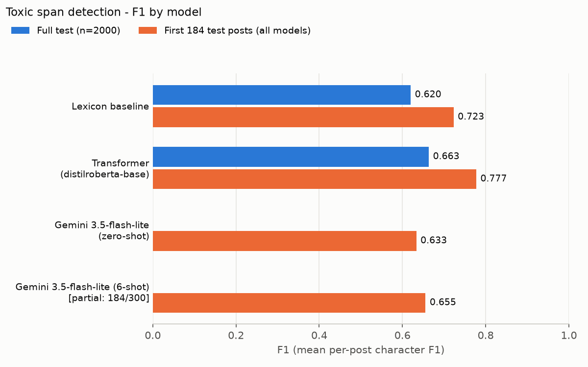

# Toxic Span Detector - Overview

## 1. Problem

Content moderation usually labels a whole comment as toxic or not. That is hard to act on: a moderator (or the author)
needs to know **which words** are the problem. Highlighting the toxic part also makes an automatic decision easier to
check, and allows softer interventions such as masking a word instead of deleting a whole post.

## 2. Task

SemEval-2021 Task 5, *Toxic Spans Detection* (Pavlopoulos et al., 2021). Input: a comment. Output: the set of
**character offsets** that make it toxic. Example (masked): in "What a st\*p\*d idea" the gold span is the characters
of the insult, offsets 7-12. A post may have no span at all, even if it is rude overall, when no particular words carry
the toxicity.

## 3. Dataset

Source: [github.com/ipavlopoulos/toxic_spans](https://github.com/ipavlopoulos/toxic_spans), folder `SemEval2021/data/`
(CSV columns `spans`, `text`). The posts are English news comments from the Civil Comments dataset, annotated by crowd
workers; the released spans are the characters kept after aggregating several annotators' highlights.

| Split | Posts | Mean length (chars) | Mean length (words) | % posts with empty spans | Mean toxic chars / post | % of chars toxic |
|---|---|---|---|---|---|---|
| train | 7939 | 204.6 | 36.2 | 6.1 | 17.5 | 8.6 |
| val | 690 | 199.5 | 35.3 | 6.2 | 14.8 | 7.4 |
| test | 2000 | 186.4 | 33.0 | 19.7 | 7.3 | 3.9 |

Notes: the official test file is labelled, so the official splits are used (train = `tsd_train`, val = `tsd_trial`,
test = `tsd_test`). The test set has many more empty-span posts (19.7% vs 6.1%) and shorter spans than train,
which matters for the metric (see section 7).

## 4. Approaches

1. **Lexicon baseline.** For every lowercase word in train, count how often it occurs and how often it lies inside a
   gold span (at least half of its characters). Keep words with `toxic_ratio >= t` and `count >= c`; `t` and `c` are
   tuned on val (grid search). Prediction marks every lexicon word in the text. Tuned values: `t = 0.3`, `c = 5`, giving 410 words.
2. **Fine-tuned transformer (token classification).** A RoBERTa-family encoder with a 2-class head on every token.
   A token's label is 1 if any non-whitespace character in its offset range is in the gold spans; special tokens are
   ignored (-100). Max length 256 tokens. At inference, token probabilities above a threshold are mapped back to
   characters through the tokenizer's offset mapping (whitespace excluded). The threshold (0.10 to 0.90) and an optional
   post-process that fills the whitespace between two consecutive toxic tokens are tuned on val. Trained here on CPU: `distilroberta-base`, 3000 training posts (seeded subsample), 2 epochs, lr 3e-05, batch 8, best epoch by val F1. Tuned threshold 0.4, whitespace fill on (val F1 0.6692 with fill vs 0.6680 without). 5 training posts and 0 val posts exceeded 256 tokens.
3. **LLM (prompting, no training).** Runs on the **Google Gemini API free tier** (`gemini-3.5-flash-lite`;
   `GEMINI_MODEL` to override). The same code can call Claude instead (`LLM_PROVIDER=anthropic`, default
   `claude-haiku-5-5`). The model is asked to return only `{"toxic_spans": ["exact substring", ...]}`. Gemini runs with
   temperature 0 and JSON output mode. Zero-shot uses instructions only; few-shot adds 6 training examples sampled with
   seed 42 (4 with spans, 2 without). The JSON is parsed robustly (code fences stripped, bad JSON counted as a failure
   and treated as "no spans"). Each substring is mapped to offsets by exact search, falling back to case-insensitive
   search, and **every occurrence is marked**, because the model returns strings, not positions. All responses are
   cached by hash of (model, shots, text), so reruns are free and reproducible. To stay inside the free tier, calls are
   throttled to one every 4.5 s, with retries on rate-limit errors, and the LLM is scored on the first 300 test posts only.

## 5. Architecture

```
                 GitHub (ipavlopoulos/toxic_spans)
                               |
                     scripts/download_data.py
                     (toxspans/data.py: parse spans safely,
                      dedupe, sort, drop out-of-range)
                               |
              data/processed/{train,val,test}.jsonl
                 |                  |                   |
       train_baseline.py   train_transformer.py    run_llm.py
       (baseline.py)       (transformer.py)        (llm.py + cache)
                 |                  |                   |
     models/baseline/     models/transformer/     data/cache/
       lexicon.json         config.json + hf/       llm_cache.jsonl
                 \                  |                   /
                  +-------- toxspans/evaluate.py -------+
                  |   same test posts, official metric   |
                  |        (toxspans/metrics.py)         |
                  v                                      v
     results/metrics.json, results.md,        results/error_analysis.md
     f1_comparison.png                        (scripts/error_analysis.py)
                               |
                         app/app.py (Streamlit)
           text -> chosen model -> char offsets -> <mark> highlight
```

All three models share one interface: `predict(text) -> sorted list of character indices`.

## 6. Metric

For each post, with P = predicted character set and G = gold set:

- Precision = |P ∩ G| / |P|, Recall = |P ∩ G| / |G|, F1 = 2·Precision·Recall / (Precision + Recall).
- If both P and G are empty, F1 = 1. If exactly one is empty, F1 = 0.
- **Headline score = mean per-post F1** (the official SemEval metric).
- The tables also report **micro** precision and recall over all characters of all posts.

The "empty" rule makes the metric strict: on a post without gold spans, predicting even one character costs the
whole post.

## 7. Results

F1 = official SemEval-2021 Task 5 metric (mean per-post character F1). Precision / Recall = micro-averaged over all characters. Latency for local models is amortised batch inference on this machine's CPU; for the LLM it is the measured API round-trip of the original (uncached) call.

### Full test set (2000 posts)

| Model | F1 | Precision | Recall | Avg latency per post | Posts evaluated |
|---|---|---|---|---|---|
| Transformer (distilroberta-base) | 0.6633 | 0.5302 | 0.7719 | 24.44 ms | 2000 |
| Lexicon baseline | 0.6198 | 0.4828 | 0.7262 | 0.03 ms | 2000 |

### Same-subset comparison: first 300 test posts

| Model | F1 | Precision | Recall | Avg latency per post | Posts evaluated |
|---|---|---|---|---|---|
| Transformer (distilroberta-base) | 0.7275 | 0.5610 | 0.8753 | 24.44 ms | 300 |
| Lexicon baseline | 0.6773 | 0.5582 | 0.7924 | 0.03 ms | 300 |
| Gemini gemini-3.5-flash-lite (6-shot) [partial: 184/300 posts] | 0.6555 | 0.5489 | 0.7714 | 1.08 s | 184 |
| Gemini gemini-3.5-flash-lite (zero-shot) | 0.5890 | 0.3825 | 0.8011 | 911.27 ms | 300 |

Rows marked *partial* did not finish (free-tier daily request quota); their F1 is on fewer posts, so compare them only in the next table, where every model is scored on the same posts.

### All models on the first 184 test posts (covered by every LLM run)

| Model | F1 | Precision | Recall | Avg latency per post | Posts evaluated |
|---|---|---|---|---|---|
| Transformer (distilroberta-base) | 0.7773 | 0.6187 | 0.9327 | 24.44 ms | 184 |
| Lexicon baseline | 0.7228 | 0.6176 | 0.8254 | 0.03 ms | 184 |
| Gemini gemini-3.5-flash-lite (6-shot) [partial: 184/300 posts] | 0.6555 | 0.5489 | 0.7714 | 1.08 s | 184 |
| Gemini gemini-3.5-flash-lite (zero-shot) | 0.6333 | 0.4296 | 0.8425 | 911.27 ms | 184 |



**Reading the results.**

- The fine-tuned transformer beats the lexicon by 0.0435 F1 on the full test set
  (0.6633 vs 0.6198), even though it is the small `distilroberta-base` trained on only
  3000 posts for 2 epochs on a CPU. It gains on every length bucket and on posts that do have toxic spans (0.819 vs
  0.758 F1, see the error analysis).
- **The LLM (Gemini, free tier) ranks last.** On the 184 posts that every model covers, F1 is 0.7773 (transformer),
  0.7228 (lexicon), 0.6555 (Gemini 6-shot) and 0.6333 (Gemini zero-shot). Zero-shot finds the toxic words
  (recall 0.8425) but marks far too much (precision 0.4296): it predicts 14.4 toxic characters per post against 7.3 in
  the gold spans, typically a whole insulting phrase where annotators marked only the key word. Six examples teach it the annotation style: precision rises to 0.5489 and F1
  by 0.0222. With only 6 labelled examples and no training, the LLM gets within 0.12 F1 of the fine-tuned model.
- The 6-shot run is **partial**: the free tier allows 500 requests per day per model, which ran out after 300 zero-shot
  and 184 few-shot posts. Rerunning `make llm` after the quota resets finishes the remaining posts from the cache, and
  `make evaluate` then reports all 300.
- All models have higher recall than precision: they also mark rude words that annotators left unmarked. On test posts
  without gold spans they score almost 0, which caps the overall F1.
- Subsets of the first posts are easier than the full test set (every model scores higher there), so subset scores
  must only be compared with each other, never with full-test scores.
- Speed: the lexicon is roughly 700x faster than the transformer (0.03 ms vs
  24.44 ms per post on CPU, amortised batch time); the LLM needs about
  0.9 to 1.1 s per API call, plus free-tier throttling.

For reference, the best SemEval-2021 Task 5 systems reached about 0.70 to 0.71 F1 on this test set (mostly large
fine-tuned transformers and ensembles).

## 8. Error analysis (summary)

Best model on the full test set: **Transformer (distilroberta-base)** (F1 = 0.6633, n = 2000).

1. **The metric punishes any prediction on clean posts.** 394 of 2000 test posts (19.7%) have no gold span; the model flagged something in 382 of them (97.0%), and each of those scores F1 = 0. Many such posts are offensive overall but annotators did not tie the toxicity to specific words (context-dependent toxicity).
2. **False positives are mostly genuinely rude words that were not annotated in that post.** 65.2% of false-positive word occurrences are words that are marked toxic in at least 30% of their training occurrences (e.g. st*p*d, ign*r*nt, id**t). Whether such a word is 'the toxic span' depends on context and annotator judgement (e.g. self-directed or quoted use, sarcasm), which a word list cannot see and a model trained on ~8k posts learns only partly.
3. **Many missed words are harmless out of context; fewer are rare or obfuscated.** 10.6% of missed word occurrences appear fewer than 3 times in training and 17 of 1850 gold spans (0.9%) contain obfuscation (asterisks or symbols inside a word). Several of the most-missed words are neutral on their own (weapons, chemical, assad, people): they are toxic only as part of a threat or accusation, which needs context rather than a word list.
4. **Boundary disagreement is common.** 594 posts (29.7%) get partial credit (0 < F1 < 1); 43 gold spans (2.3%) are phrases of 4+ words where annotators marked a whole insult or threat, while models mark only the strongest word.
5. **Longer posts are harder.** F1 by length bucket for the best model: < 100 chars: 0.759, 100-199: 0.657, 200-399: 0.601, >= 400: 0.450. Long posts give more chances for both extra and missed words; posts over 256 tokens are also truncated for the transformer.

Full tables (masked) are in [results/error_analysis.md](results/error_analysis.md).

## 9. Limitations and ethics

- **Offensive content.** The data contains insults, slurs and threats. This repository never prints more than 5 posts at a
  time, and documents/UI show only mild examples or masked words (`st*p*d`).
- **Annotation subjectivity.** Gold spans come from a few crowd workers; many rude words are left unmarked in some posts
  and marked in others. A model learns these inconsistencies, and the strict metric penalises disagreement on clean posts.
- **Bias.** Identity terms (religion, ethnicity, gender, politics) appear in toxic contexts in the training data, so models
  can flag them in neutral sentences, which would unfairly target the groups they name. Any deployment needs a bias audit.
- **Context and language.** Sarcasm, implicit threats, coded language and obfuscated spellings are often missed. The models
  are English-only and trained on news comments; other domains will behave differently.
- **Use.** This is a moderator's aid that explains *why* a comment might be toxic, not an automatic censor. Decisions should
  stay with people, with a way to appeal.
- **Privacy.** The LLM approach sends text to Google (Gemini) or Anthropic (Claude). Free-tier Gemini requests may be used
  by Google to improve its products, so never send private or personal data through it without consent.

## 10. Future work

- Train `roberta-base` / `roberta-large` on the full training set on a GPU (the Colab notebook does `roberta-base`).
- Add a post-level "is anything toxic?" gate to reduce false positives on empty-span posts.
- CRF or BIO tagging so whole phrases are predicted as one span; ensembling lexicon + transformer + LLM.
- Character-level or byte-level models for obfuscated words; data augmentation with masked spellings.
- Prompt the LLM for offsets directly (or with structured outputs) and evaluate more models and shot counts.

## 11. Repository structure

```
toxic-spans/
├── README.md, OVERVIEW.md, USAGE.md, DECISIONS.md
├── Makefile, requirements.txt, pyproject.toml, .env.example
├── src/toxspans/        data.py, metrics.py, utils.py, baseline.py, transformer.py, llm.py,
│                        evaluate.py, error_analysis.py
├── scripts/             download_data.py, train_baseline.py, train_transformer.py, run_llm.py,
│                        evaluate.py, error_analysis.py, make_colab_notebook.py
├── app/app.py           Streamlit demo
├── notebooks/           colab_train.ipynb
├── tests/               pytest suite (metric, parsing, offsets, mocked LLM, app)
├── results/             metrics.json, results.md, f1_comparison.png, error_analysis.md, data_stats.md
├── data/                raw + processed + LLM cache (gitignored)
└── models/              baseline + transformer weights (gitignored)
```
